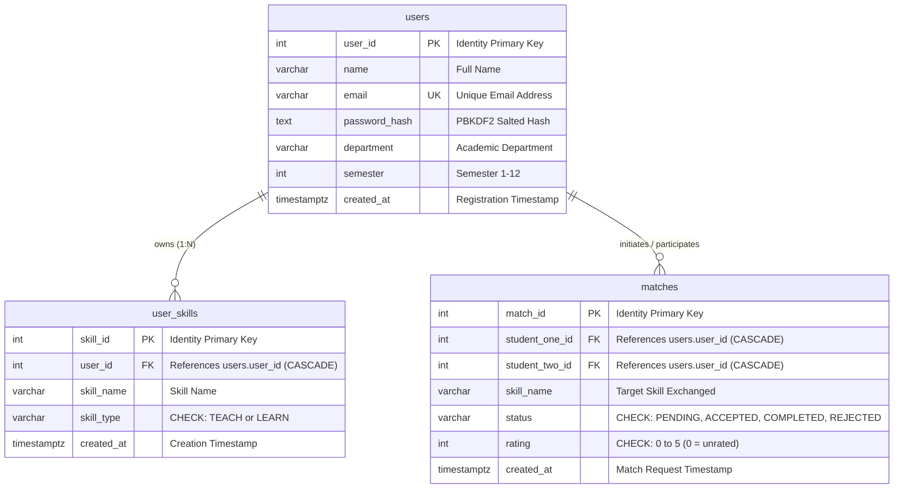

# SkillBarter — Peer Skill Exchange Platform

> **"Learn Together. Grow Together."**  
> An academic mini-project for 3rd-semester B.Tech Computer Science and Engineering demonstrating Core Object-Oriented Programming (OOP) in Java, JDBC, Java Servlets (Jakarta EE / Apache Tomcat 10+), and PostgreSQL hosted on Supabase.

---

## Table of Contents
1. [Project Overview](#1-project-overview)
2. [Key Features](#2-key-features)
3. [Technology Stack](#3-technology-stack)
4. [Final Project Structure](#4-final-project-structure)
5. [OOP Concepts Demonstrated (Viva Reference)](#5-oop-concepts-demonstrated-viva-reference)
6. [Request Lifecycle Architecture](#6-request-lifecycle-architecture)
7. [Database Schema & Relationships](#7-database-schema--relationships)
8. [Supabase Setup Guide](#8-supabase-setup-guide)
9. [JDBC Driver & Dependency Setup](#9-jdbc-driver--dependency-setup)
10. [Environment Variables Configuration](#10-environment-variables-configuration)
11. [Compilation & Tomcat Deployment](#11-compilation--tomcat-deployment)
12. [Application URL & API Servlet Routes](#12-application-url--api-servlet-routes)
13. [Testing Procedure](#13-testing-procedure)
14. [Common Errors & Troubleshooting](#14-common-errors--troubleshooting)
15. [Security & Viva FAQs](#15-security--viva-faqs)
16. [Known Limitations](#16-known-limitations)

---

## 1. Project Overview

**SkillBarter** is a web-based peer skill exchange platform built specifically for college students. Students often possess valuable skills (like Java, Web Development, or Python) while seeking guidance in other domains (such as Database Management, Machine Learning, or Graphic Design). 

SkillBarter provides a cashless, reciprocal skill-swapping system:
- A student registers with their academic details (department, semester).
- They list skills they can **TEACH** (offer) and skills they wish to **LEARN** (seek).
- The platform identifies **reciprocal matches** (Student A teaches what Student B wants, and Student B teaches what Student A wants).
- Students send match requests, collaborate, mark exchanges as completed, and leave ratings (1 to 5 stars).

---

## 2. Key Features

- **Student Authentication:** Secure registration and login using industry-standard salted PBKDF2 with HMAC-SHA256 password hashing.
- **Session Management:** Secure server-side `HttpSession` invalidating upon logout.
- **Skill Inventory:** Add, view, and delete personal skills categorized as `TEACH` or `LEARN`.
- **Peer Discovery:** Browse teaching skills offered by other students across all departments.
- **Reciprocal Matching Engine:** Automated algorithm matching complementary teaching and learning needs between distinct students.
- **Exchange Lifecycle Management:** Full state machine (`PENDING` &rarr; `ACCEPTED` / `REJECTED` &rarr; `COMPLETED`).
- **Rating System:** Post-exchange ratings (1–5 stars) to build peer credibility.
- **Responsive UI:** Clean, modern interface designed with pure HTML5, CSS3, and Vanilla JavaScript (no external frontend frameworks).

---

## 3. Technology Stack

### Backend
- **Core Java (JDK 17 / 21 / 26):** Object-oriented classes, inheritance, polymorphism, encapsulation, and interfaces.
- **Java Collections Framework:** `ArrayList` for dynamic records and `HashMap` for skill categorization.
- **Jakarta Servlet API 6.0:** HTTP request handling, session tracking, and REST endpoints.
- **Raw JDBC (Java Database Connectivity):** `PreparedStatement`, `ResultSet`, and connection pooling over SSL.
- **Web Server:** Apache Tomcat 10.1+ (or 11+).

### Database
- **PostgreSQL on Supabase:** Cloud-hosted relational database connected via JDBC over SSL (`sslmode=require`).

### Frontend
- **HTML5 & CSS3:** Semantic markup, responsive flexbox/grid layout, custom design system.
- **Vanilla JavaScript (ES6+):** Asynchronous Fetch API client handling JSON responses without frameworks.

### Prohibited Tools (Strictly Respected)
*No Spring Boot, No Maven/Gradle, No Hibernate/JPA, No Node.js backend, No React/Vue/Angular, No mock databases.*

---

## 4. Final Project Structure

```
SkillBarter/
├── src/
│   ├── model/
│   │   ├── User.java                 # Abstract base class (Abstraction & Encapsulation)
│   │   ├── Student.java              # Concrete subclass (Inheritance & Polymorphism)
│   │   ├── Skill.java                # Skill model with TEACH/LEARN domain validation
│   │   └── Match.java                # Match model with status & rating validation
│   ├── interfaces/
│   │   ├── Matchable.java            # Interface declaring skill-matching behavior
│   │   └── Rateable.java             # Interface declaring rating & validation behavior
│   ├── util/
│   │   ├── DBConnection.java         # JDBC SSL connection factory using env vars
│   │   ├── PasswordUtil.java         # PBKDF2WithHmacSHA256 password security utility
│   │   └── JsonUtil.java             # Lightweight JSON serialization & parser
│   ├── dao/
│   │   ├── UserDAO.java              # JDBC data access for students and profiles
│   │   ├── SkillDAO.java             # JDBC data access for user skills & discovery
│   │   └── MatchDAO.java             # JDBC data access for matches & reciprocal search
│   ├── service/
│   │   └── SkillExchangeService.java # Core logic implementing Matchable & Rateable
│   └── servlet/
│       ├── RegisterServlet.java      # Handles /api/register
│       ├── LoginServlet.java         # Handles /api/login
│       ├── LogoutServlet.java        # Handles /api/logout
│       ├── ProfileServlet.java       # Handles /api/profile
│       ├── SkillServlet.java         # Handles /api/skills & /api/skills/discover
│       └── MatchServlet.java         # Handles /api/matches, suggestions, status, rating
│
├── WebContent/
│   ├── index.html                    # Platform landing page & features
│   ├── login.html                    # Student authentication portal
│   ├── register.html                 # Student signup form
│   ├── dashboard.html                # Real-time metrics, profile view & edit
│   ├── skills.html                   # Skill inventory & peer discovery
│   ├── matches.html                  # Reciprocal suggestions & match manager
│   ├── css/
│   │   └── style.css                 # Responsive stylesheet (Navy/Blue theme)
│   ├── js/
│   │   └── app.js                    # Fetch API client, state, & UI helpers
│   └── WEB-INF/
│       ├── web.xml                   # Jakarta EE 6.0 deployment descriptor
│       ├── classes/                  # Compiled .class files (gitignored)
│       └── lib/
│           └── postgresql-42.7.3.jar # PostgreSQL JDBC runtime driver
│
├── sql/
│   └── schema.sql                    # Production PostgreSQL DDL & indexes
├── lib/
│   ├── README.txt                    # Library documentation
│   ├── postgresql-42.7.3.jar         # PostgreSQL JDBC driver
│   └── jakarta.servlet-api-6.0.0.jar # Standalone compilation servlet library
├── test/
│   └── TestRunner.java               # Automated CLI test suite for OOP & logic
├── build.bat                         # Windows Command Prompt build & package script
├── build.ps1                         # Windows PowerShell build & package script
├── .env.example                      # Template for Supabase credentials
├── .gitignore                        # Git ignore configuration
└── README.md                         # Project documentation
```

---

## 5. OOP Concepts Demonstrated (Viva Reference)

| OOP Concept | Code Implementation | Viva Explanation |
| :--- | :--- | :--- |
| **Abstraction** | [`User.java`](src/model/User.java) | `User` is declared `abstract` with the abstract method `public abstract String getRole()`. It defines the core template of a user without revealing implementation details. |
| **Inheritance** | [`Student.java`](src/model/Student.java) | `Student extends User` inherits attributes (`userID`, `name`, `email`, `passwordHash`) using `super(...)` and extends them with `department` and `semester`. |
| **Encapsulation** | All model classes | All entity fields are `private`. Access is granted exclusively through validated `getters` and `setters`. For example, `Skill.setSkillType()` rejects anything other than `TEACH` or `LEARN`. |
| **Polymorphism** | `getRole()` in `Student` | The abstract method `getRole()` from `User` is overridden in `Student` to return `"Student"`. Dynamic method dispatch determines the behavior at runtime. |
| **Interfaces** | [`Matchable`](src/interfaces/Matchable.java) & [`Rateable`](src/interfaces/Rateable.java) | Pure behavioral contracts implemented by [`SkillExchangeService`](src/service/SkillExchangeService.java). Promotes loose coupling. |
| **Collections** | `ArrayList` & `HashMap` | `ArrayList` stores variable lists of skills and match records. `HashMap` categorizes skills by type (`TEACH` vs `LEARN`) and builds API JSON maps. |

---

## 6. Request Lifecycle Architecture

```
[Browser / Client]
       │  (HTTP Fetch JSON Request)
       ▼
[Java Servlet (Controller)] ──(RegisterServlet / SkillServlet / MatchServlet)
       │  (Validates session & input parameters)
       ▼
[Service Layer] ─────────────(SkillExchangeService implements Matchable, Rateable)
       │  (Applies business rules: reciprocal matching, status transitions)
       ▼
[DAO Layer] ─────────────────(UserDAO / SkillDAO / MatchDAO)
       │  (Constructs parameterized SQL queries using PreparedStatement)
       ▼
[JDBC Driver over SSL] ──────(PostgreSQL 42.7.3 Driver with sslmode=require)
       │  (TCP / TLS Connection)
       ▼
[Supabase PostgreSQL] ───────(Executes relational queries on public schema)
```

---

## 7. Database Schema & Relationships

The database comprises exactly 3 relational tables:



### Constraints & Integrity:
- **Foreign Keys:** Cascading deletes (`ON DELETE CASCADE`) delete all skills and matches if a student account is removed.
- **Check Constraints:** 
  - `skill_type IN ('TEACH', 'LEARN')`
  - `status IN ('PENDING', 'ACCEPTED', 'COMPLETED', 'REJECTED')`
  - `rating >= 0 AND rating <= 5`
  - `student_one_id <> student_two_id` (prevents self-matching).

---

## 8. Supabase Setup Guide

1. Log in to [Supabase](https://supabase.com) and create or open your project.
2. In the left navigation, click on **SQL Editor**.
3. Click **New Query**.
4. Open [`sql/schema.sql`](sql/schema.sql) in this repository, copy its full content, paste it into the SQL Editor, and click **Run**.
5. Verify the tables by running the verification query included at the bottom of `sql/schema.sql`.
6. Navigate to **Project Settings** &rarr; **Database**:
   - Scroll to **Connection parameters** or **Connection Pooling (Session Mode)**.
   - Note the **Host**, **Port** (usually `5432` for direct or `6543` for pooler), **Database name** (`postgres`), and **User** (e.g., `postgres.yourprojectref`).

---

## 9. JDBC Driver & Dependency Setup

Because Maven and Gradle are prohibited, all required JARs are managed in `lib/`:
1. **PostgreSQL JDBC Driver:** [`lib/postgresql-42.7.3.jar`](lib/postgresql-42.7.3.jar)  
   *(Official download: [jdbc.postgresql.org/download](https://jdbc.postgresql.org/download/))*
2. **Jakarta Servlet API:** [`lib/jakarta.servlet-api-6.0.0.jar`](lib/jakarta.servlet-api-6.0.0.jar)  
   *(Used for local CLI compilation).*

The build script automatically places `postgresql-42.7.3.jar` into `WebContent/WEB-INF/lib/` so Tomcat's webapp classloader discovers it at runtime.

---

## 10. Environment Variables Configuration

Set your Supabase credentials in your environment. Never commit real credentials to GitHub.

### On Windows PowerShell:
```powershell
$env:SUPABASE_DB_HOST = "aws-0-ap-south-1.pooler.supabase.com"
$env:SUPABASE_DB_PORT = "6543"
$env:SUPABASE_DB_NAME = "postgres"
$env:SUPABASE_DB_USER = "postgres.your_project_ref"
$env:SUPABASE_DB_PASSWORD = "Your_Supabase_Database_Password"
```

### On Windows Command Prompt (cmd):
```cmd
set SUPABASE_DB_HOST=aws-0-ap-south-1.pooler.supabase.com
set SUPABASE_DB_PORT=6543
set SUPABASE_DB_NAME=postgres
set SUPABASE_DB_USER=postgres.your_project_ref
set SUPABASE_DB_PASSWORD=Your_Supabase_Database_Password
```

*(You can also set these permanently in Windows System Properties &rarr; Environment Variables).*

---

## 11. Compilation & Tomcat Deployment

### Option A: Using the Automated Build Script
Run the PowerShell build script:
```powershell
.\build.ps1
```
Or on Command Prompt:
```cmd
build.bat
```
This will:
1. Compile all Java source files into `WebContent/WEB-INF/classes`.
2. Copy the PostgreSQL JDBC driver to `WebContent/WEB-INF/lib/`.
3. Package the complete web application into `SkillBarter.war`.

### Option B: Deploying to Apache Tomcat 10.1+
1. Copy the generated `SkillBarter.war` to your Tomcat installation's `webapps/` folder:
   ```powershell
   Copy-Item "SkillBarter.war" "$env:CATALINA_HOME\webapps\"
   ```
2. Start Apache Tomcat:
   ```cmd
   %CATALINA_HOME%\bin\startup.bat
   ```
3. Open your browser to:
   ```
   http://localhost:8080/SkillBarter/
   ```

---

## 12. Application URL & API Servlet Routes

| Endpoint | HTTP Method | Protected | Description |
| :--- | :--- | :---: | :--- |
| `/` or `/index.html` | `GET` | No | Landing page with platform overview |
| `/login.html` | `GET` | No | Student login page |
| `/register.html` | `GET` | No | New student registration page |
| `/dashboard.html` | `GET` | Yes | Student dashboard with stats & profile |
| `/skills.html` | `GET` | Yes | Skill management & discovery portal |
| `/matches.html` | `GET` | Yes | Reciprocal suggestions & match manager |
| `/api/register` | `POST` | No | Register new student with PBKDF2 hash |
| `/api/login` | `POST` | No | Authenticate credentials & initialize session |
| `/api/logout` | `POST` | Yes | Invalidate session |
| `/api/profile` | `GET`, `PUT` | Yes | View and update profile details |
| `/api/skills` | `GET`, `POST` | Yes | List student skills or add new skill |
| `/api/skills?id={id}` | `DELETE` | Yes | Delete an owned skill |
| `/api/skills/discover` | `GET` | Yes | Browse teaching skills offered by peers |
| `/api/matches` | `GET`, `POST` | Yes | List matches or request a new match |
| `/api/matches/suggestions` | `GET` | Yes | Fetch reciprocal match opportunities |
| `/api/matches/status` | `POST`, `PUT` | Yes | Transition match status (ACCEPTED/REJECTED/COMPLETED) |
| `/api/matches/rating` | `POST` | Yes | Submit 1–5 star rating for completed match |

---

## 13. Testing Procedure

### 1. Run Automated Unit & Logic Tests
Execute the standalone test suite directly from your terminal:
```powershell
javac -encoding UTF-8 -cp "WebContent\WEB-INF\classes;lib\*" -d WebContent\WEB-INF\classes test\TestRunner.java
java -cp "WebContent\WEB-INF\classes;lib\*" test.TestRunner
```
This tests:
- OOP inheritance and polymorphism (`Student extends User`).
- Domain validation on `Skill` (`TEACH`/`LEARN`) and `Match` (self-match prevention, status & rating bounds).
- Cryptographic security of `PasswordUtil` (PBKDF2 with unique salts).
- `SkillExchangeService` reciprocal compatibility.
- Live database connectivity (when environment variables are configured).

### 2. End-to-End Application Testing
1. **Registration:** Navigate to `register.html` and create two students:
   - **Student 1:** Alice (teaches *Java*, wants to learn *Python*).
   - **Student 2:** Bob (teaches *Python*, wants to learn *Java*).
2. **Login:** Log in as Alice.
3. **Skills Inventory:** Add *Java* as `TEACH` and *Python* as `LEARN`.
4. **Logout & Login as Bob:** Add *Python* as `TEACH` and *Java* as `LEARN`.
5. **Reciprocal Suggestions:** Open `matches.html` under Bob's account. Notice that Alice appears in **Smart Reciprocal Suggestions**!
6. **Request Exchange:** Click **Request Exchange**. The match is created in `PENDING` state.
7. **Acceptance:** Log in as Alice, open `matches.html`. Accept Bob's request. Status updates to `ACCEPTED`.
8. **Completion:** Mark the exchange as `COMPLETED`.
9. **Rating:** Submit a 5-star rating for the exchange.

---

## 14. Common Errors & Troubleshooting

| Error | Root Cause | Solution |
| :--- | :--- | :--- |
| `java.lang.ClassNotFoundException: org.postgresql.Driver` | PostgreSQL driver JAR is missing from Tomcat runtime classpath. | Ensure `postgresql-42.7.3.jar` is located in `WebContent/WEB-INF/lib/` or Tomcat's `lib/` directory. |
| `Missing environment variable: SUPABASE_DB_HOST` | Required Supabase environment variables are not set. | Set `SUPABASE_DB_HOST`, `SUPABASE_DB_USER`, and `SUPABASE_DB_PASSWORD` before starting Tomcat. |
| `Connection refused: connect` | Incorrect port or host in connection string. | For Supabase Session Pooler, use port `6543`. For direct connections, use `5432`. |
| `HTTP 401 Unauthorized` | Attempted access to protected API without an active session. | Log in via `login.html` first to establish a session cookie. |
| `Self-match rejected` | Attempted to match a student with themselves. | By business logic design, a student cannot request an exchange with themselves. |

---

## 15. Security & Viva FAQs

### Q1: Why use PBKDF2 instead of plain SHA-256 for passwords?
> **Answer:** SHA-256 is designed to be fast, making it vulnerable to brute-force and dictionary attacks via GPUs. PBKDF2 (Password-Based Key Derivation Function 2) applies HMAC-SHA256 across 65,536 iterations with a cryptographically secure random 16-byte salt, making offline cracking computationally prohibitive.

### Q2: How does the application prevent SQL Injection?
> **Answer:** All database operations in `UserDAO`, `SkillDAO`, and `MatchDAO` strictly use parameterized queries via `PreparedStatement`. Parameter values are sent separately from the SQL statement structure, preventing SQL injection attacks.

### Q3: How is authentication verified on protected endpoints?
> **Answer:** We never trust a `userID` supplied by frontend query parameters. Instead, the student's identity is retrieved securely on the server from the authenticated `HttpSession`.

---

## 16. Known Limitations

- **Email Verification:** Student email addresses are validated for standard syntax, but verification email links are omitted to keep the academic setup simple and dependency-free.
- **Single Active Exchange Rating:** The match record stores one consensus rating per exchange session.
